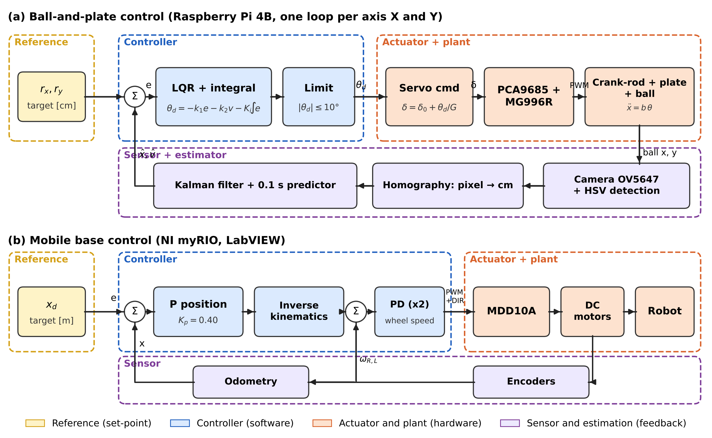
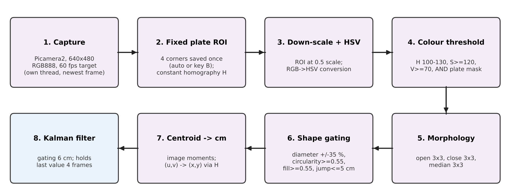
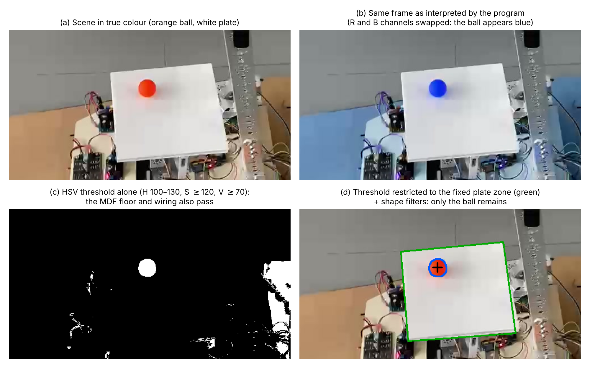
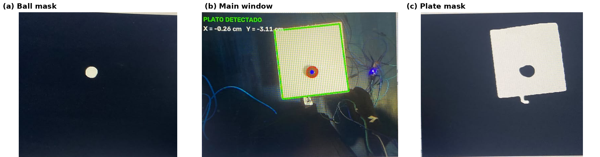

# Vision-Based Mobile Ball-and-Plate System

Vision-based control of a mobile ball-and-plate system using a cascade architecture:
**LQR for the ball** (outer loop, vision) + **PID for the wheels/motors** (inner loop, actuation).

The camera detects the ball, the LQR controller calculates the optimal plate tilt
to bring the ball to the center, and the PID controller drives the wheels/motors
to achieve that tilt without overshoot or oscillation.


## Table of Contents
- [System Overview](#system-overview)
- [Control Architecture](#control-architecture)
- [Vision Pipeline](#vision-pipeline)
- [Repository Structure](#repository-structure)
- [How to Run](#how-to-run)
- [Experimental Results](#experimental-results)
- [Hardware](#hardware)
- [Technologies](#technologies)

## System Overview

This project is a mobile ball-and-plate system developed for EC2 - HardwareX v6.

The goal is to keep a green ball balanced at the center of a moving plate, using
only vision as the main feedback sensor for the ball position.

Main components:
- Mobile platform with tilting plate
- DC motors / servomotors for tilt actuation
- Camera for ball detection
- myRIO for real-time control and communication
- Python + OpenCV for vision and control


## Control Architecture

This system does NOT use a single controller. It uses **two controllers in cascade**:


### 1. Outer Loop: LQR for the Ball (Vision)

The LQR controller is the brain of the system.

- Input: Ball position and velocity estimated from the camera
- State vector: `[x, y, vx, vy, theta_x, theta_y]`
- Output: Desired plate inclination `theta_x_ref`, `theta_y_ref`

LQR is used here because the ball-on-plate is a multivariable system
(2 axes coupled). LQR finds the optimal tilt that minimizes both
position error and control effort, which gives smoother and more
stable behavior than a simple PID for the ball.



### 2. Inner Loop: PID for Wheels / Motors

The PID controller is the muscle of the system.

- Input: Desired tilt from LQR
- Output: Motor / servo commands via UART to myRIO
- Goal: Reach the desired tilt fast, without overshoot or steady-state error

PID is used here because it is fast, robust, and ideal for direct
motor control where we need quick response and disturbance rejection.

Tested variants for the inner loop:
- PD
- PD aggressive (high gains)
- PD2
- PID with smooth integral (to remove steady-state error)

> **Summary:** LQR decides **WHAT** tilt is needed. PID decides **HOW** to move the motors to achieve it.

## Vision Pipeline

1. Camera capture
2. RGB -> HSV conversion
3. Green color segmentation by HSV thresholding
4. Morphological cleaning (opening / closing)
5. Centroid detection with `moments` / `connectedComponents`
6. Position + velocity estimation for LQR





## Repository Structure

### Code Description

| File | What it does |
|---|---|
| `Control10-3_v7_UART.py` | Main control: PID for wheels + UART communication |
| `enlace_myrio.py` | Communication link with myRIO |
| `analisis_resultados.py` | Analysis and plots of experimental results |
| `pid_metrics.py` | Metrics: overshoot, settling time, steady-state error |
| `pid_figs.py` | Generation of PID figures |

### Data Description

The CSVs in `datos/` are from the **inner loop (PID for wheels/motors)** tests:

| File | Controller | Test |
|---|---|---|
| `PD_01.csv` | PD | Base PD test |
| `PD_03_P1.csv` | PD | PD test, configuration 03 - P1 |
| `PD_03_P2.csv` | PD | PD test, configuration 03 - P2 |
| `PD_03_P3.csv` | PD | PD test, configuration 03 - P3 |
| `PD_AGRESIVO.csv` | PD aggressive | High gains: faster, more overshoot |
| `PD2_04_1.csv` | PD2 | Second version PD, test 04-1 |
| `PD2_04_2.csv` | PD2 | Second version PD, test 04-2 |
| `PD2_04_3.csv` | PD2 | Second version PD, test 04-3 |
| `PD2_05_1.csv` | PD2 | Second version PD, test 05-1 |
| `PD2_05_2.csv` | PD2 | Second version PD, test 05-2 |
| `PD2_05_3.csv` | PD2 | Second version PD, test 05-3 |
| `PD2_10.csv` | PD2 | Second version PD, test 10 |
| `PID_integral_suave.csv` | PID | PID with smooth integral to remove steady-state error |

## How to Run

### 1. Install dependencies

```bash
pip install -r requirements.txt

python codigo/Control10-3_v7_UART.py

python codigo/analisis_resultados.py
python codigo/pid_metrics.py
