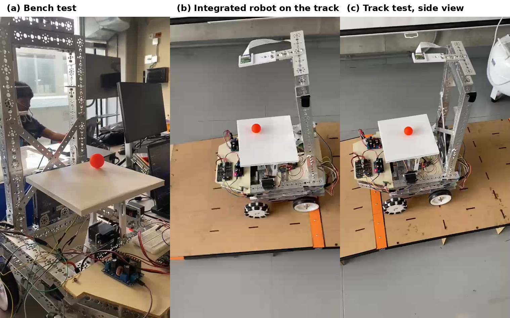
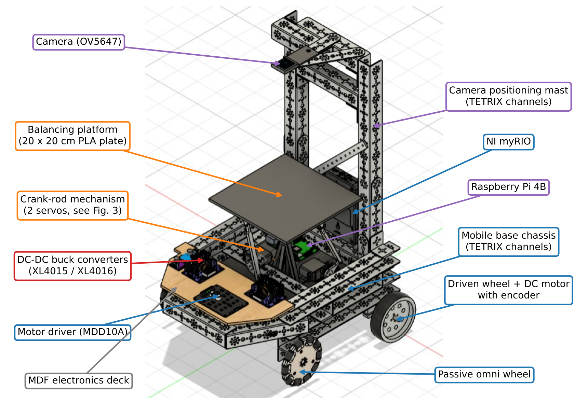
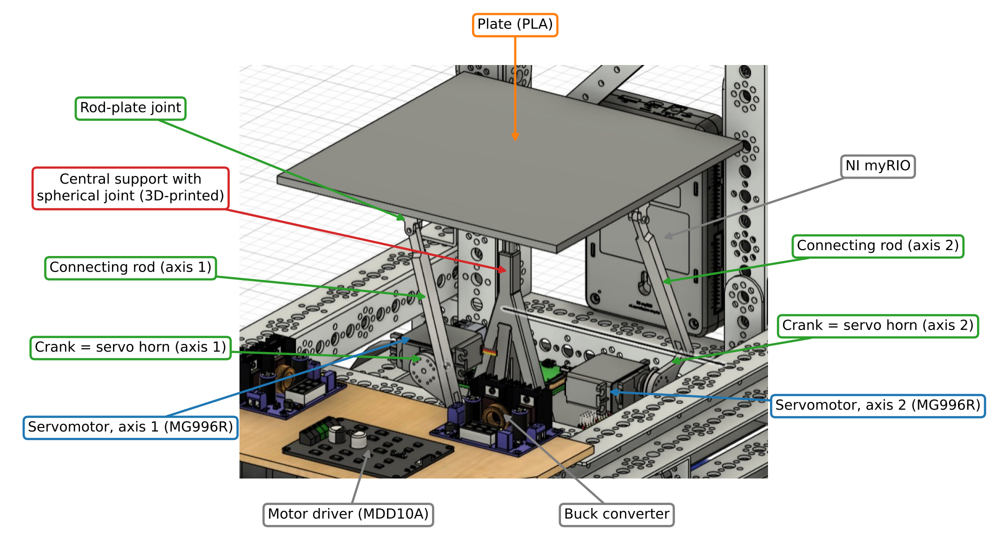

# Vision-Based Mobile Ball-and-Plate System

Vision-based control of a mobile ball-and-plate system using a cascade architecture:
**LQR for the ball** (outer loop, vision) + **PID for the wheels/motors** (inner loop, actuation).

The camera detects the ball, the LQR controller calculates the optimal plate tilt
to bring the ball to the center, and the PID controller drives the wheels/motors
to achieve that tilt without overshoot or oscillation.

## Table of Contents
- [System Overview](#system-overview)
- [Control Architecture](#control-architecture)
- [Vision Pipeline](#vision-pipeline)
- [Repository Structure](#repository-structure)
- [How to Run](#how-to-run)
- [Experimental Results](#experimental-results)
- [Hardware](#hardware)
- [Technologies](#technologies)

## System Overview

This project is a mobile ball-and-plate system developed for EC2 - HardwareX v6.

The goal is to keep a green ball balanced at the center of a moving plate, using
only vision as the main feedback sensor for the ball position.

Main components:
- Mobile platform with tilting plate
- 【entity-DC¦canonical_name=DC】 motors / servomotors for tilt actuation
- Camera for ball detection
- myRIO for real-time control and communication
- Python + OpenCV for vision and control

## Control Architecture

This system does NOT use a single controller. It uses **two controllers in cascade**:
